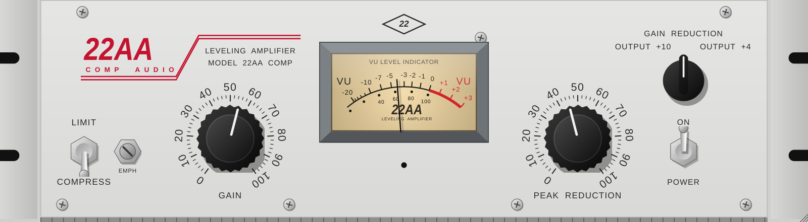

# 22AA comp

Compresor / limitador óptico estilo LA-2A (la misma función que el CLA-2A de Waves), en formato **VST3 para macOS** (Apple Silicon + Intel), pensado para Ableton Live.



## Controles

| Control | Qué hace |
|---|---|
| **Peak Reduction** | Cantidad de compresión (ganancia del sidechain). Súbelo hasta que la aguja en modo *Gain Reduction* baje lo que quieras. |
| **Gain** | Ganancia de salida (make-up). 50 = 0 dB, rango ±20 dB. |
| **Limit / Compress** | Abajo = Compress (ratio ~3:1, rodilla muy suave). Arriba = Limit (ratio ~20:1). |
| **EMPH** (tornillo) | Énfasis de agudos en el sidechain: el compresor reacciona más a los agudos (útil para voces sibilantes). |
| **Selector del VU** | Output +10 / Gain Reduction / Output +4. |
| **Power** | Encendido / bypass (con crossfade sin clics). |

Doble clic en cualquier perilla la devuelve a su valor por defecto.

## Cómo se comporta

- Detector RMS estéreo enlazado.
- Modelo de celda óptica T4: ataque ~10 ms; release en dos etapas — el 50 % se recupera en ~60 ms y el resto tarda entre ~1 s y ~5 s según cuánto tiempo y cuánto se haya comprimido (dependiente del programa, como el original).
- Color sutil de válvula/transformador (2.º armónico), sin latencia.

## Instalar en macOS

1. Descarga `22AA-comp-macOS-VST3.zip` desde **Actions → último build → Artifacts** (o desde **Releases**).
2. Descomprime y copia `22AA comp.vst3` en `~/Library/Audio/Plug-Ins/VST3/`.
3. Como el plugin no está firmado con un certificado de Apple, quita la cuarentena en Terminal:
   ```
   xattr -dr com.apple.quarantine ~/Library/Audio/Plug-Ins/VST3/"22AA comp.vst3"
   ```
4. En Ableton: *Settings → Plug-Ins → Use VST3 Plug-In System Folders* activado → *Rescan*.

## Compilar tú mismo

```
cmake -S . -B build -DCMAKE_BUILD_TYPE=Release
cmake --build build --config Release
```

Requiere CMake 3.22+ y Xcode command line tools. JUCE se descarga solo.

## Licencia

Construido con [JUCE](https://juce.com) 8 (AGPLv3 / licencia comercial de JUCE). Para distribuirlo comercialmente revisa los términos de licencia de JUCE.
